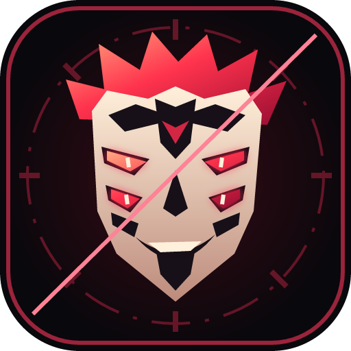

<p align="center"></p>

<h1 align="center">INNO360 · The Jujutsu Chapter</h1>
<p align="center"><strong>A hackathon website by Rahul Shyam.</strong><br>Built for the Department of Civil Engineering, Erode Sengunthar Engineering College.</p>
<p align="center"><a href="https://civilhack.vercel.app/">Visit the website</a> · <a href="https://www.linkedin.com/in/rahulshyamcivil/">Meet Rahul</a> · <a href="MEDIA-CREDITS.md">Media credits</a></p>

## The idea

INNO360 brings civil engineering, sustainability and student creativity together. This website gives the event a Jujutsu Kaisen-inspired identity: manga typography, crimson seals, domain cinematics and a Sukuna-inspired icon, with the practical event information close at hand.

I wanted visitors to enjoy exploring the site and still find the themes, rules, venue, coordinators and bus routes quickly.

— **Rahul Shyam**

## The event

| | Details |
| --- | --- |
| Event | Inno360 2026 — EcoThon & CADathon |
| Host | Department of Civil Engineering, Erode Sengunthar Engineering College (Autonomous) |
| Date | 15th October 2026 |
| Schedule | 8 AM–8 PM IST · 12 hours |
| Venue | Kailaimani A. Munusamy Mudaliyar Arangam, Thudupathi, Perundurai, Erode |
| EcoThon | Environment and sustainability solutions; all streams, including Arts and Diploma, at 12th-standard level and above |
| CADathon | Planning, design and analysis; Civil Engineering students only |
| Teams | 3–4 members · ₹250 per student |
| Registration | Advance registration only. **No on-spot registration.** |

Both themes use problem statements given at the event. Teams need at least one laptop; CADathon software must be installed before arrival. Lunch, refreshments and physical participation certificates are included, with cash prizes for winners.

The event date has passed. Registration and countdown screens use the configured event dates; this repository preserves the event website.

## Explore the site

- **Eight domain themes:** Unlimited Void, Malevolent Shrine, Chimera Shadow Garden, Coffin of the Iron Mountain, Self-Embodiment of Perfection, Horizon of the Captivating Skandha, Deadly Sentencing and Idle Death Gamble.
- **Ten character techniques:** the domain cast plus Nobara's Resonance and Yuji's Black Flash.
- **Focused cinematics:** the call, formation and reveal, without extended battle aftermath. Video and its original soundtrack share one MP4 timeline, so buffering cannot make a separate voice file run ahead.
- **Playback controls:** pause, replay, shared sound toggle and close. Only one foreground cinematic owns sound. Ambient loops stay muted and pause offscreen.
- **Event guide:** two themes, eligibility, preparation rules, team fees, venue and coordinator contacts.
- **Transport finder:** 41 official college routes with search, starting points, departure times and call links. Confirm event-day service with the transport team.
- **College showcase:** the 3D concrete printing centre, products, student projects and college social profiles.
- **Personal touches:** Rahul Shyam's creator credit and profiles, plus an animated SVG favicon, standard device icons and a 4K PNG master.

Deadly Sentencing and Dagon use original Japanese scene audio. Hakari is explicitly labelled **fan animation with Japanese audio**. Other character clips use English-dub source excerpts. Browser support determines whether the SVG favicon animates.

## Run it locally

Use Node.js 22.12 or newer and npm.

```sh
npm ci
npm run dev
```

Open the local URL printed by Vite, normally `http://localhost:3000`.

```sh
npm test           # Playback ownership and cleanup regression tests
npm run lint       # TypeScript checks
npm run build      # Production build in dist/
npm run preview    # Serve the production build locally
```

The current website does not require an API key to display event information or play its bundled clips. `.env.example` contains inherited starter settings; never commit real credentials.

## Media quality checks

For the deeper asset audit, install Python 3 and FFmpeg, including `ffprobe`, on your PATH:

```sh
npm run media:check
```

The audit decodes all ten clips and checks H.264/AAC compatibility, audio presence and level, aligned stream starts and durations, fast-start MP4 layout and approved clip-length limits. It does not replace reviewing the dialogue and visual cut.

The reviewed source timestamps and language labels are recorded in [`src/data/character-media.json`](src/data/character-media.json). Detailed sources and asset history are in [`MEDIA-CREDITS.md`](MEDIA-CREDITS.md). See [`QA_REPORT.md`](QA_REPORT.md) for the browser checks, clip durations and testing limits.

## Project map

| Location | Purpose |
| --- | --- |
| `src/config/constants.ts` | Event facts, contacts, bus routes and domain themes |
| `src/pages/HomePage.tsx` | Landing page, entrance and domain selection |
| `src/pages/EventPortalPage.tsx` | Full event guide |
| `src/components/AnimeVideo.tsx` | Combined video/audio player and controls |
| `src/components/TechniqueArena.tsx` | Character technique lab |
| `src/context/DomainThemeContext.tsx` | Selected theme and domain playback requests |
| `src/utils/characterMedia.ts` | Exclusive foreground playback and cleanup |
| `src/sections/Footer.tsx` | College links and Rahul Shyam's creator credit |
| `public/assets/jjk/media/*-synced.mp4` | Active, synchronized character clips |
| `scripts/audit-media.py` | Decode, audio and duration audit |
| `vercel.json` | Build settings and application-route rewrites |

## Routes and hosting

| Route | Page |
| --- | --- |
| `/` | Jujutsu-themed landing page |
| `/portal`, `/event` | Complete event information |
| `/register` | Team and registration instructions |
| `/status` | Reporting guidance; coordinator verification is required |
| `/review`, `/reviews` | Review schedule and countdown |

The site uses **React 19, TypeScript, Vite 8, Tailwind CSS, Motion and Lucide**, and is hosted on Vercel. Import this repository with its included `vercel.json`: install with `npm ci`, build with `npm run build`, and publish `dist/`. Route rewrites allow direct visits to the pages above.

There is no connected registration/payment-verification API. College registration totals are a dated local snapshot, not a live attendance count. Registration links point to the official Google Form.

## Credits and ownership

Website design, direction and maintenance: **Rahul Shyam**.

Jujutsu Kaisen characters, anime footage and related names belong to their respective rights holders. This is an unofficial themed college-event project, without claimed franchise affiliation. Media is credited individually; this repository does not grant rights to reuse third-party footage, college logos or artwork. Self-hosted fonts include their accompanying licences.

Artwork documentation: [`ARTWORK.md`](ARTWORK.md) · [`TECHNIQUE-ARTWORK.md`](TECHNIQUE-ARTWORK.md) · [`MEDIA-CREDITS.md`](MEDIA-CREDITS.md).

## Find Rahul

[LinkedIn](https://www.linkedin.com/in/rahulshyamcivil/) · [GitHub](https://github.com/rahulcvwebsitehosting) · [Instagram — @rahulcvjps](https://www.instagram.com/rahulcvjps/) · [Threads — @rahulcvjps](https://www.threads.com/@rahulcvjps)
